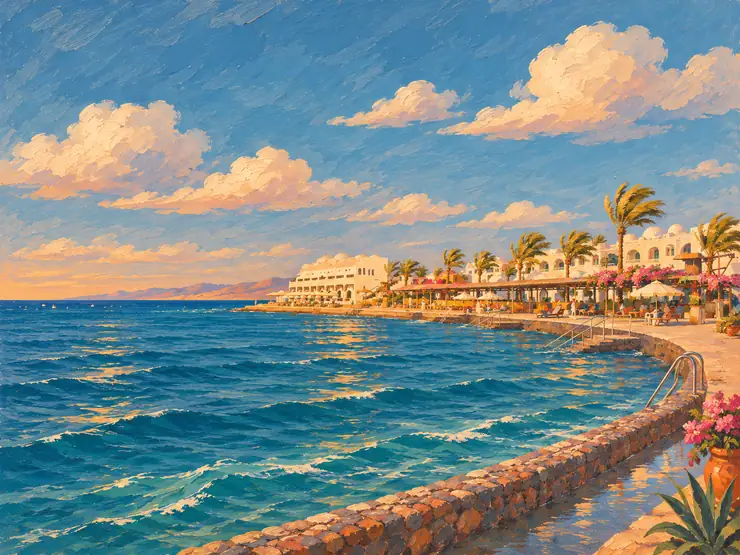
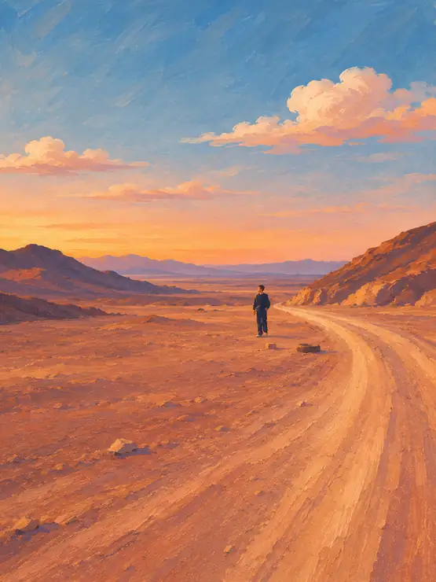

# Vintage Travel Gouache · Painterly（油画涂抹感）

以**更明显、自由、富有方向感的手绘笔触**表现复古旅行海报。不透明水粉结合柔和油画式扫涂；天空、云朵、海浪和山石的颜料涂抹感更突出，主体形体仍清楚。相比 Refined，画面更奔放、更具手工绘画肌理。

**不需要风格参考图。** 仅上传需要改绘的**目标照片**；纯文字原创时不需要任何图片。下面展示的是已生成的创作案例，**仅用于 README 展示，Skill 不会自动加载它们作为风格参考**。

## 实际创作示例

| 海滨酒店 · 海浪与云朵的明显笔触 | 荒漠落日 · 岩石与天空的层叠涂抹 |
| :---: | :---: |
|  |  |

## 安装与调用

将本文件夹完整复制到 `~/.agents/skills/vintage-travel-gouache-painterly/` 或项目 `.agents/skills/vintage-travel-gouache-painterly/`，并在可使用图像生成/编辑工具的 Agent 中明确调用：

> 使用 `vintage-travel-gouache-painterly` 把我的照片画成笔触明显的复古旅行海报水粉插画，保留原图主体与构图，允许适度补景。不使用任何额外风格参考图。

## 主要文件
- [SKILL.md](SKILL.md)：任务触发、画法 DNA、生成流程和质量控制
- [风格规则](references/style-guide.md)：色彩、构图与不同区域笔触
- [提示词](references/prompt-templates.md)：中英提示词和局部修正
- [调用示例](examples/example-requests.md)：海滨、荒漠、人物和原创场景

> Skill 提供工作流程与提示词，不内置绘图模型；生成效果受具体模型与随机性影响。
