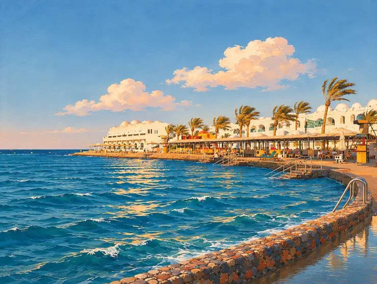
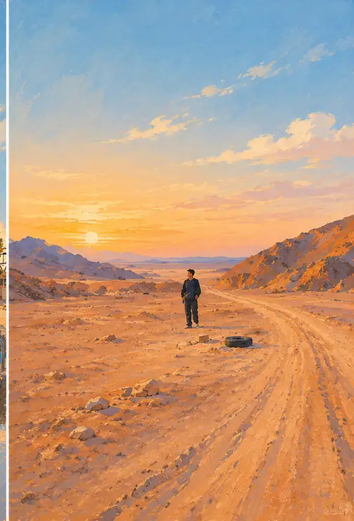

# Vintage Travel Gouache · Refined（精致轻纹理）

以**精致的20世纪中期商业旅行海报与哑光不透明水粉**为核心。大面积天空轻薄、平滑，只有极淡的颜料微颗粒；云朵局部塑形，海浪、山石和树冠使用贴合结构的细腻短笔触。相比 Painterly，更克制、更接近精细商业插画。

**不需要风格参考图。** 仅上传要改绘的**目标照片**；纯文字原创时不需要任何图片。下面展示的是已生成的创作案例，**仅用于 README 展示，Skill 不会自动加载它们作为风格参考**。

## 实际创作示例

| 海滨酒店 · 天空轻薄，海浪精细 | 荒漠落日 · 大面积平滑天空 |
| :---: | :---: |
|  |  |

## 安装与调用

将本文件夹完整复制到 `~/.agents/skills/vintage-travel-gouache-refined/` 或项目 `.agents/skills/vintage-travel-gouache-refined/`，并在支持图像生成/编辑的 Agent 中明确调用：

> 使用 `vintage-travel-gouache-refined` 把这张照片改绘成精致复古旅行海报水粉插画。保留主体，允许适度扩景；天空平滑轻薄、几乎没有笔痕，只在海水、山石和树冠保留局部精细笔触。不使用风格参考图。

## 主要文件
- [SKILL.md](SKILL.md)：核心工作流与天空强制约束
- [分区域笔触](references/region-texture-map.md)：天空、云、水面、岩石和建筑的质感分配
- [视觉风格 DNA](references/visual-style-dna.md)：形体和插画气质
- [配色与光照](references/palette-and-lighting.md)：适应地点和时段
- [提示词](references/prompt-templates.md)：中英模板与天空局部修复
- [质量检查](references/comparison-and-qa.md)：验收与修复
- [调用示例](examples/example-requests.md)：常见场景

> Skill 提供工作流程与提示词，不内置绘图模型；生成效果受具体模型与随机性影响。
